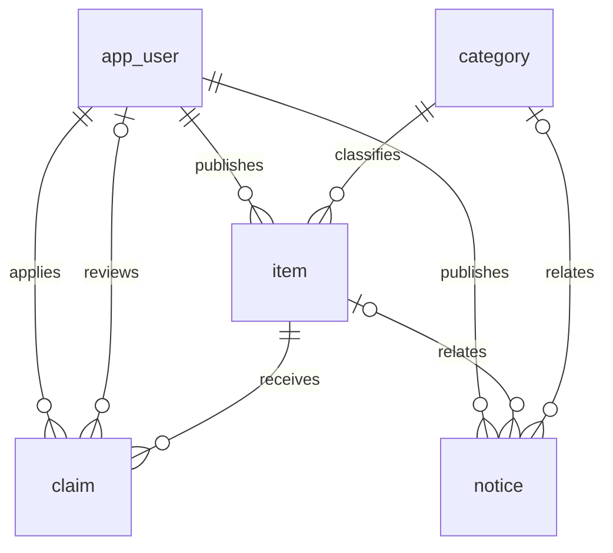

# 数据库设计

## 1. 数据库与命名

正式数据库 MySQL 8.0，库名 campus_lost_found，字符集 utf8mb4。用户表使用 app_user 避免 SQL 关键字冲突。演示与自动测试使用 H2 MySQL 兼容模式，和正式库分离。

## 2. 表和字段

| 表       | 字段                                                                                                                                                          | 说明                                                             |
| -------- | ------------------------------------------------------------------------------------------------------------------------------------------------------------- | ---------------------------------------------------------------- |
| app_user | id, student_number, name, phone, password, role, enabled, created_at, updated_at                                                                              | 学号/手机号各自唯一；role 为 user 或 admin；BCrypt 密码          |
| category | id, name, sort_no, enabled, created_at, updated_at                                                                                                            | 分类名称唯一；sort_no 升序；停用后不可用于新发布                 |
| item     | id, user_id, category_id, title, type, location, occurred_at, description, contact, status, created_at, updated_at, finished_at                               | lost/found；open/finished/closed；发生时间独立于发布时间         |
| claim    | id, item_id, user_id, description, status, reply, reviewer_id, publisher_status, publisher_reply, publisher_confirmed_at, created_at, updated_at, reviewed_at | pending/approved/rejected；一人一物唯一；审核人及审核时间        |
| notice   | id, publisher_id, item_id, category_id, title, content, kind, enabled, published_at, starts_at, expires_at, created_at, updated_at                            | system/reminder/result；公告发布者和业务关联；截止为空为长期有效 |

所有 id 为 BIGINT 自增。详细类型、长度、默认值和外键见 database/init-mysql.sql；该文件与后端 schema.sql 的表结构保持一致。

## 3. 关系

notice.publisher_id 必填，只能由管理员操作接口写入；编辑公告保留原始发布者。notice.item_id、category_id 可同时关联；业务端要求 reminder/result 至少保留一项关联（删除物品后会解除物品关联，公告本身仍保留）。类别不能在仍被引用时删除。

## 4. 时间条目与展示规则

统一使用 Asia/Shanghai。API 日期格式 yyyy-MM-dd HH:mm:ss。前端 datetime 表单传本地日期；后端验证并存为时间戳。

- occurred_at：物品实际丢失或拾到时间，不得晚于当前时间（容许 1 分钟时钟误差）。
- item.created_at / updated_at / finished_at：发布、最后修改、完结时间。
- claim.created_at / reviewed_at / updated_at：申请、审核、最后变动时间。
- notice.published_at：编辑指定的公告发布时间；未来时间表示暂不公开。
- notice.starts_at：生效时间；notice.expires_at：截止时间，必须晚于发布时间和生效时间。
- 公告展示：enabled=true 且 published_at≤now 且 starts_at≤now 且（expires_at 为空或 expires_at>now）。

## 5. 一致性与删除

审核通过、更新物品、驳回其他待审申请在一个事务中完成，先锁定物品，再锁定申请。关闭、完结、撤回和删除使用相同的物品优先锁定顺序。删除物品时申请级联删除，公告关联物品设空；用户不提供删除，只提供禁用。分类删除遇外键约束返回 409，建议停用。

初始化不会清空数据。schema.sql 使用 CREATE TABLE IF NOT EXISTS，结构本身不用于升级已有其他结构的表；本项目用于新建数据库，后续结构变更需单独编写迁移 SQL。

## 6. 讲稿补充字段与旧库升级

claim.publisher_status：pending 待招领人确认、confirmed 已确认、rejected 已拒绝、legacy 历史处理记录。publisher_reply 保存核对说明，publisher_confirmed_at 保存招领人处理时间。管理员批准要求 publisher_status=confirmed；招领人拒绝不填写 reviewer_id/reviewed_at。SchemaUpgrade 在启动时对旧表补列并将旧 student 角色改为 user，无须删除原库；具体见 database/upgrade-v2.sql 和 07 文档。
