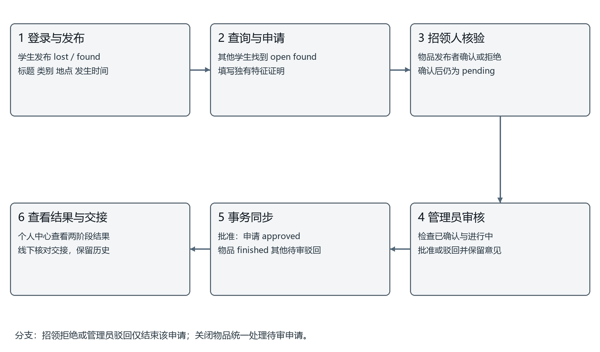

# 校园失物招领管理系统需求说明书

## 1 系统概述

### 1.1 建设背景与目标

校园卡、钥匙、雨伞、耳机和书本等物品经常在校园内遗失。微信群、QQ群和线下公告能够传播信息，但记录分散，消息难以按名称、地点和时间筛选，认领后的状态也不易更新。本系统将失物与招领统一登记，使学生能够查询线索、提交归属证明，并追踪从申请、招领人确认到管理员审核完结的全过程。

系统采用浏览器访问方式，面向普通游客、学生用户和管理员。核心目标是有记录、可查询、能追踪：信息具有明确的发布者与发生时间；物品可按多个条件检索；每条申请有独立处理结果；正常认领完成后保留历史，便于查看处理依据。

### 1.2 范围与交付

本期建设范围包括注册登录、失物与招领发布、搜索详情、认领申请、招领人确认、个人中心、管理员维护、分类、公告及数量统计。程序以本地运行和课程验收为主，使用 MySQL 8 作为正式数据库，同时提供无需 MySQL 密码的独立 H2 演示模式。GitHub 用于保存代码和文档，不作为本期必须交付的在线业务服务器。

物品图片上传、短信验证、校园统一身份认证、自动匹配、聊天、在线支付和独立搜索引擎不在已实现范围内。姓名与学号由注册者填写，当前系统不具备与学校学籍库核验身份的能力。

### 1.3 依据与需求取舍

需求依据为小组最初的九页功能 PPT、汇报讲稿及后续公告关联和时间条目要求。讲稿进一步确定 BCrypt、JWT 角色、中文检索和招领人确认环节。实现中用 app_user 作为用户表物理名称，用于避免通用 user 名称引起的命名歧义。

讲稿提及认领后删除招领信息。为同时满足 PPT 的状态追踪目标，正常审核采用更新 item.status 为 finished 并保留记录；无效或重复内容仍可由授权用户显式删除。该取舍使默认大厅不再展示已完结信息，又能在历史筛选和个人中心追溯认领结果。

## 2 用户角色与权限

### 2.1 角色定义

| 角色 | 身份与入口 | 允许操作 | 约束 |
| --- | --- | --- | --- |
| 普通游客 | 不登录进入寻物大厅与公告栏 | 浏览列表、搜索、查看公开详情和生效公告 | 不能发布、申请或查看联系方式 |
| 学生用户 | 学号或手机号加密码登录 | 本人发布维护、提交和撤回本人待审申请、查看结果、确认本人发布物品的申请 | 不能修改他人发布，不能审核全站申请 |
| 管理员 | 既有管理员账号登录后进入工作台 | 用户启停、物品维护、申请审核、分类公告维护、统计 | 仍需遵守状态与数据约束，不能跳过招领人确认直接批准 |

招领人不是新增账号角色，而是某一件 found 物品的发布者。同一学生可以在一条业务中充当招领人，在另一条业务中充当申请人。管理员与学生使用同一登录入口，系统识别角色；不提供访客自行注册管理员的功能。

### 2.2 权限落实原则

前端隐藏无权限入口，后端独立校验 JWT 签名、有效期、角色和数据库账号状态。普通用户对发布记录的维护必须匹配 item.user_id，对申请撤回必须匹配 claim.user_id，对归属确认必须匹配关联物品发布者。仅修改网页参数不能获得他人的操作权限。

管理员可以维护全站物品，但“招领人确认”要求实际物品发布者本人完成。用户管理展示角色并启停学生账号，当前没有修改角色或创建额外管理员的管理界面，管理员账号也不允许通过该接口停用。

## 3 功能需求说明

### 3.1 注册登录与账号管理

FR01 注册登录：学生填写学号、姓名、手机号和密码。学号长度为 4 至 30 字符且只允许字母数字；姓名 1 至 50 字符；手机号须为 11 位并符合 1[3-9] 开头的格式。学号、手机号分别设置唯一约束。密码为 8 至 64 字符且 UTF-8 编码不超过 72 字节，使用 BCrypt 保存，不保存明文。

登录可输入学号或手机号。密码错误统一提示账号或密码错误，停用账号拒绝登录。成功后返回用户资料并签发含 user/admin 角色的 JWT，默认有效一小时。退出撤销当前凭证并清除 Cookie；默认随机签名密钥下，程序重启需重新登录。系统不提供找回密码、短信验证码或修改密码页面。

FR09 用户管理：管理员查看用户编号、学号、姓名、手机号、角色、启用状态及时间。启停仅改变 enabled 与更新时间，账号和历史关联保留。账号停用后，后续受保护请求也重新检查数据库状态并拒绝访问。

### 3.2 失物与招领发布

FR02 发布与维护：登录用户填写标题、类型、类别、地点、实际发生时间、描述和联系方式。lost 表示本人遗失寻找，found 表示拾获等待主人。标题 2 至 100 字符，地点 1 至 100，描述 5 至 5000，联系方式 3 至 100；类别必须存在且启用。发生时间不能为空，不得晚于当前时间超过一分钟。

新信息初始为 open。学生在个人中心修改本人进行中的信息；已有认领申请的物品不能更改 lost/found 类型。已完结或关闭的物品不能修改主要内容，也不能重新开启。维护者可以完结或关闭信息；状态变为非 open 时，相关待审申请同步驳回。显式删除会删除关联申请，并解除公告的物品关联，执行前应确认是否确属无效记录。

### 3.3 搜索与详情

FR03 检索详情：支持标题和描述关键词、分类、地点、lost/found 类型、物品状态及实际发生时间起止范围组合筛选。关键词总长不超过 100 字符，最多 8 个空格分隔词；多个词同时匹配，适用于中文子串。起止时间包含边界，开始时间不得晚于结束时间。

列表分页默认每页 12 条，后端限制每页 1 至 100 条，按发布时间和编号倒序排列。前端大厅默认筛选进行中；选择已完结或已关闭可查看历史。详情展示发布人、类别、地点、实际发生时间、描述和状态；联系方式只对有效登录用户开放，列表接口始终不输出联系方式。

### 3.4 认领申请与招领人确认

FR04 提交与撤回：只能申请他人发布且进行中的 found 物品，填写 10 至 3000 字符归属证明。一人对同一物品最多保留一条申请；重复申请由数据库唯一约束拒绝。本人可以撤回 pending 申请，撤回采用删除该申请记录；其他人不能撤回。

FR05 招领人确认：物品发布者在个人中心“收到的认领申请”中查看申请说明，填写 1 至 500 字符核对意见，选择确认归属或拒绝。确认后 publisher_status=confirmed，申请主状态仍为 pending，等待管理员审核；拒绝后申请主状态为 rejected，并保留招领人说明。不能重复处理，也不能为已关闭或完结物品确认。

### 3.5 管理员审核与个人中心

FR06 认领审核：管理员查看申请人、关联物品、归属证明、招领确认状态和意见。批准要求申请为 pending、物品为 open、招领人为 confirmed；批准时同一事务将该申请置 approved、物品置 finished、其他待审申请置 rejected，并记录审核人及时间。驳回可直接处理不合理申请，不要求先确认，也不完结物品。

FR07 个人中心：分开提供“我的发布”“我的认领申请”“收到的认领申请”。申请人同时看到招领人处理与管理员处理，不能把“已确认”显示为“已批准”。正常完结保留记录。物品认领通过代表系统审核完成，线下交接仍由双方根据联系方式核对完成，当前没有单独交接签收功能。

FR08 物品管理：管理员可查看全站物品并修改状态、删除无效信息。系统不自动物理删除审核通过的招领内容；必要时通过状态筛选查看历史。数据统计用于辅助维护，不替代认领处理记录。

### 3.6 分类与公告

FR10 分类管理：管理员维护名称、排序和启用状态。名称唯一，排序为整数。停用后不用于新发布，但原有物品保留其分类关联。被物品或公告引用的分类不能删除，建议停用。

FR11 公告管理：公告栏承担服务通知、招领提醒和认领结果三个用途。系统通知说明平台服务与安排；招领提醒引导查看物品或分类；认领结果用于管理员确认后的公开说明。公告不用于公开申请人的全部隐私特征，不自动将申请证明复制为公告。

每条公告必关联发布管理员 publisher_id；item_id、category_id 可选，提醒和结果至少关联其中一个。界面可进入关联物品或按关联分类筛选。记录发布时间 published_at、生效时间 starts_at、截止时间 expires_at、创建时间和修改时间。首页只显示启用、已发布、已生效且未过期的公告；截止为空表示长期。截止时间必须严格晚于发布时间和生效时间。管理员可查看包括未来、停用与过期内容在内的全部公告。

FR12 统计查看：公共页面展示物品总数、进行中和完结数；管理后台提供待审申请数、用户数、分类及失物/招领数量。统计反映查询时的数据库记录，不宣称有尚未实现的趋势预测或使用率分析。

## 4 业务流程与状态规则

### 4.1 完整认领流程

学生登录后发布信息，其他学生通过搜索定位物品，查看时间地点和描述，提交独有特征证明。招领人核对后确认，再由管理员最终审核。申请人到个人中心查看结果，并与招领人线下交接。驳回仅结束对应申请，其他符合条件的用户仍可申请进行中的物品。

### 4.2 状态与删除边界

| 对象 | 起始状态 | 可到达状态 | 关键条件 |
| --- | --- | --- | --- |
| item | open | finished 或 closed | 本人或管理员维护，或批准申请同步完结 |
| item | finished | closed | 保留 finished_at，不可回 open |
| item | closed | 无再次开启 | 已终止信息 |
| claim | pending | approved 或 rejected | 批准须招领确认；拒绝可由招领人或管理员处理 |
| publisher_status | pending | confirmed 或 rejected | 仅关联物品实际发布者操作 |

撤回和删除没有额外状态枚举。待审撤回物理删除申请；管理员清理物品级联删除申请；停用学生不删除用户。历史升级可能出现 publisher_status=legacy，仅用于旧记录标识，不作为新申请的正常状态。

## 5 非功能需求与验收

### 5.1 数据安全与可靠性

使用参数化 SQL，密码使用带随机盐的 BCrypt；JWT 校验 HS256、发行者、过期时间及角色。受保护操作同时核对数据库用户状态。Cookie 使用 HttpOnly、SameSite=Lax，本地 HTTP 运行不设置 Secure。写接口要求 X-Requested-With: campus，前端统一发送；该措施不能替代身份鉴权。

认领、确认、审核、关闭和删除按物品后申请的顺序加锁。审核通过时各表修改在同一事务完成，异常回滚，防止同一物品有多条批准记录。数据时间统一按 Asia/Shanghai 展示。展示空列表、无权限、登录失效、输入错误与服务器异常时应提供明确提示。

当前验证包含桌面及 390px 手机布局、并发批准和数据库一致性。尚未进行大规模性能压测，不把响应时间或最大并发量写成已经达到的指标。课程使用时，以功能正确、状态一致和可以复现为首要验收条件。

### 5.2 需求追溯与验收标准

| 需求 | 程序模块与表 | 测试项 | 验收标准 |
| --- | --- | --- | --- |
| FR01 FR09 | AuthController Auth JwtTokens；app_user | T01 T02 T09 T13 | 学号/手机号登录、BCrypt、角色及禁用即时生效 |
| FR02 FR03 FR08 | ItemController；item category | T02 T03 T06 T10 T16 | 本人维护、中文组合检索、时间筛选、历史可查 |
| FR04 FR05 FR06 FR07 | ItemController AdminController；claim item | T04 T05 T12 T14 T15 | 提交、确认、审核完整闭环，一物仅一条批准 |
| FR10 FR11 | AdminController；category notice | T07 T08 T10 | 分类约束、公告三类用途、关联跳转与有效期过滤 |
| FR12 | AdminController；数据库聚合查询 | 浏览器管理后台检查 | 数量与现有记录一致，区分待审与已完结 |
| 数据完整性 | schema.sql SchemaUpgrade 演示SQL | T17 T18 真实MySQL验收 | 旧库升级保留记录，重复导入不增加重复数据 |

## 6 文档体系与变更管理

瀑布式交付依次形成需求说明书、数据库设计说明书、程序设计说明书、测试说明书、部署维护说明书和用户使用说明书。需求条目采用 FR 编号，测试沿用源码 T01 至 T18，数据字典和接口路径与 SQL 及 Controller 保持一致。

需求发生变化时，先确认业务含义与受影响权限、数据和状态，再同步修改程序、测试、说明书及操作步骤。每次正式更新同时写入本地 web 和 GitHub 仓库，记录提交编号并校验文件一致。PPT 后续另行修改，本批文档不以旧展示 PPT 作为程序实现依据。
