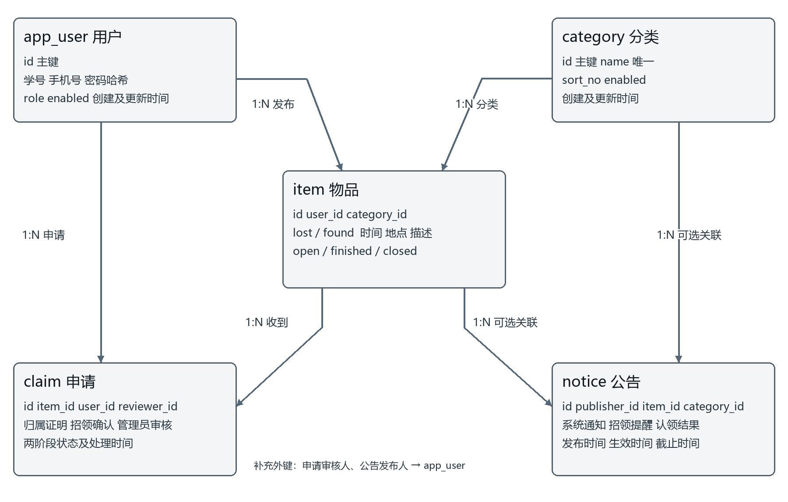

# 校园失物招领管理系统数据库设计说明书

## 1 系统概述

### 1.1 数据库目标与环境

数据库支撑账号、失物与招领、分类、认领申请及公告五类业务。正式数据库名称为 campus_lost_found，采用 MySQL8 和 utf8mb4_unicode_ci，用户表使用 app_user。H2 以 MySQL 兼容模式用于本地演示和自动测试，不能据此替代真实 MySQL 验收。

本设计与 database/init-mysql.sql、后端 schema.sql、SchemaUpgrade 及 Controller 一致。ID均为 BIGINT 自增主键；时间在接口中按 yyyy-MM-dd HH:mm:ss 及 Asia/Shanghai 表达。created_at、updated_at 在建表时默认当前时间，后续修改由应用显式更新 updated_at，没有声明数据库 ON UPDATE 自动刷新。

### 1.2 数据流与设计原则

注册产生 app_user；发布时引用 app_user 与 category 形成 item；申请引用 item 与申请用户形成 claim；发布者身份通过 item.user_id 推导，不在 claim 冗余保存。管理员审核保留 reviewer_id。公告引用发布管理员并可选引用物品或分类，承担跨业务导航。

需求层保证仅授权用户执行操作，数据库层保证唯一性和外键完整性，事务保证跨记录状态变化同时成功。角色枚举、业务长度、公告有效期和招领确认前置条件主要由后端校验，不能把它们误写成数据库已经设置的 CHECK 约束。

## 2 概念结构与实体关系

### 2.1 实体关系图

一个用户可以发布多件物品，也可以提交多条申请；一个分类可以包含多件物品；一个物品可以收到多条申请。申请人和审核人都引用 app_user，招领确认操作者由物品发布者确定。公告发布者必须存在，物品和分类关联可为空。

### 2.2 关系与删除策略

| 外键或关联 | 父表 | 基数和可空性 | 删除与维护规则 |
| --- | --- | --- | --- |
| item.user_id | app_user.id | 多对一，非空 | 用户不提供删除接口，使用启停 |
| item.category_id | category.id | 多对一，非空 | 被引用分类禁止删除 |
| claim.item_id | item.id | 多对一，非空 | 删除物品时 ON DELETE CASCADE |
| claim.user_id | app_user.id | 多对一，非空 | 申请用户必须存在 |
| claim.reviewer_id | app_user.id | 多对一，可空 | 待审或仅招领人处理时可无管理员 |
| notice.publisher_id | app_user.id | 多对一，非空 | 后端限定发布者为管理员 |
| notice.item_id | item.id | 多对一，可空 | 删除物品时 ON DELETE SET NULL |
| notice.category_id | category.id | 多对一，可空 | 被引用分类禁止删除 |

物品删除后的公告可能同时失去唯一物品关联，但公告正文仍保留。这是外键删除策略的结果；新增或重新编辑提醒、结果公告时仍需满足至少有一个有效业务关联。正常认领采用完结保留，避免用级联删除代替业务闭环。

## 3 物理表结构与数据字典

### 3.1 用户表 app_user

用户表统一保存学生和管理员身份，student_number、phone 分别唯一。name 不设置唯一约束。password 保存 BCrypt 哈希，role 为 user/admin，enabled 为账号启停标志。

| 字段名 | 数据类型 | 允许为空 | 默认值 | 说明 |
| --- | --- | --- | --- | --- |
| id | BIGINT | 否 | 自增 | 自增主键 |
| student_number | VARCHAR(30) | 否 | 无 | 学号或管理员账号，唯一 |
| name | VARCHAR(50) | 否 | 无 | 用户姓名，不唯一 |
| phone | VARCHAR(11) | 否 | 无 | 11位手机号，唯一 |
| password | VARCHAR(100) | 否 | 无 | BCrypt哈希，不保存明文 |
| role | VARCHAR(16) | 否 | 'user' | user学生或admin管理员 |
| enabled | BOOLEAN | 否 | TRUE | 是否启用 |
| created_at | TIMESTAMP | 否 | CURRENT_TIMESTAMP | 创建时间 |
| updated_at | TIMESTAMP | 否 | CURRENT_TIMESTAMP | 最后修改时间 |

### 3.2 分类表 category

分类维护名称、排序和启用状态，按 sort_no、id 升序展示。名称唯一。停用后仍保留历史关联，但不能用于新建或编辑物品时选择。

| 字段名 | 数据类型 | 允许为空 | 默认值 | 说明 |
| --- | --- | --- | --- | --- |
| id | BIGINT | 否 | 自增 | 自增主键 |
| name | VARCHAR(50) | 否 | 无 | 分类名称，唯一 |
| sort_no | INT | 否 | 0 | 分类显示顺序，较小值在前 |
| enabled | BOOLEAN | 否 | TRUE | 是否启用 |
| created_at | TIMESTAMP | 否 | CURRENT_TIMESTAMP | 创建时间 |
| updated_at | TIMESTAMP | 否 | CURRENT_TIMESTAMP | 最后修改时间 |

### 3.3 物品表 item

一张表统一保存 lost 与 found，通过 type 区分。occurred_at 是实际丢失或拾获时间，created_at 是系统发布时间，不能混用。状态由 open 转为 finished 或 closed，finished 可进一步 closed；不允许恢复为 open。

| 字段名 | 数据类型 | 允许为空 | 默认值 | 说明 |
| --- | --- | --- | --- | --- |
| id | BIGINT | 否 | 自增 | 自增主键 |
| user_id | BIGINT | 否 | 无 | 发布用户，外键app_user.id |
| category_id | BIGINT | 否 | 无 | 所属分类，外键category.id |
| title | VARCHAR(100) | 否 | 无 | 标题 |
| type | VARCHAR(10) | 否 | 无 | lost失物或found招领 |
| location | VARCHAR(100) | 否 | 无 | 丢失或拾获地点 |
| occurred_at | TIMESTAMP | 否 | 无 | 实际发生时间 |
| description | TEXT | 否 | 无 | 外观、物品特征与丢失拾获经过 |
| contact | VARCHAR(100) | 否 | 无 | 联系方式，详情中登录可见 |
| status | VARCHAR(16) | 否 | 'open' | open/finished/closed |
| created_at | TIMESTAMP | 否 | CURRENT_TIMESTAMP | 创建时间 |
| updated_at | TIMESTAMP | 否 | CURRENT_TIMESTAMP | 最后修改时间 |
| finished_at | TIMESTAMP | 是 | NULL | 物品完结时间，可空 |

### 3.4 认领申请表 claim

status 表示最终申请状态，publisher_status 表示招领人核验状态，二者必须分别展示。确认后 status 仍为 pending。reply 和 reviewer_id 属于管理员审核或系统同步处理信息；publisher_reply 和 publisher_confirmed_at 属于发布者处理记录。个别随物品关闭的系统驳回由执行维护操作的账号记录，不应一概认定 reviewer_id 都来自管理员人工审核。

| 字段名 | 数据类型 | 允许为空 | 默认值 | 说明 |
| --- | --- | --- | --- | --- |
| id | BIGINT | 否 | 自增 | 自增主键 |
| item_id | BIGINT | 否 | 无 | 申请物品，外键item.id |
| user_id | BIGINT | 否 | 无 | 提交申请的用户，外键app_user.id |
| description | TEXT | 否 | 无 | 申请人填写的独有特征证明 |
| status | VARCHAR(16) | 否 | 'pending' | pending/approved/rejected |
| reply | VARCHAR(500) | 是 | NULL | 审核或系统处理意见 |
| reviewer_id | BIGINT | 是 | NULL | 审核或系统处理操作者，可空 |
| publisher_status | VARCHAR(16) | 否 | 'pending' | pending/confirmed/rejected；legacy为历史升级 |
| publisher_reply | VARCHAR(500) | 是 | NULL | 招领人核验意见 |
| publisher_confirmed_at | TIMESTAMP | 是 | NULL | 招领人处理时间，可空 |
| created_at | TIMESTAMP | 否 | CURRENT_TIMESTAMP | 创建时间 |
| updated_at | TIMESTAMP | 否 | CURRENT_TIMESTAMP | 最后修改时间 |
| reviewed_at | TIMESTAMP | 是 | NULL | 管理员或系统审核处理时间 |

唯一键 uq_claim_user_item(item_id,user_id) 使同一人对同一物品只能保留一条申请。pending撤回物理删除后可重新申请；已驳回记录仍在时不能再次提交同一物品。legacy 只用于旧库迁移的招领确认标记，不是新流程批准条件。

### 3.5 公告表 notice

kind 为 system、reminder、result。publisher_id 必填，管理员创建时从登录用户赋值；编辑不篡改原发布者。item_id 和 category_id 可以同时关联。公告不仅是一段独立文字，还将服务通知与物品、分类及处理结果连接起来。

| 字段名 | 数据类型 | 允许为空 | 默认值 | 说明 |
| --- | --- | --- | --- | --- |
| id | BIGINT | 否 | 自增 | 自增主键 |
| publisher_id | BIGINT | 否 | 无 | 发布公告的管理员ID |
| item_id | BIGINT | 是 | NULL | 关联物品，可空，删除物品时置空 |
| category_id | BIGINT | 是 | NULL | 关联分类，可空 |
| title | VARCHAR(100) | 否 | 无 | 公告标题 |
| content | TEXT | 否 | 无 | 公告正文 |
| kind | VARCHAR(16) | 否 | 'system' | system/reminder/result |
| enabled | BOOLEAN | 否 | TRUE | 是否启用 |
| published_at | TIMESTAMP | 否 | 无 | 公告发布时间，可设未来 |
| starts_at | TIMESTAMP | 否 | 无 | 公告生效时间 |
| expires_at | TIMESTAMP | 是 | NULL | 公告截止时间，可空为长期 |
| created_at | TIMESTAMP | 否 | CURRENT_TIMESTAMP | 创建时间 |
| updated_at | TIMESTAMP | 否 | CURRENT_TIMESTAMP | 最后修改时间 |

## 4 约束与查询设计

### 4.1 主键 唯一键和索引

| 对象 | 已有约束 | 目的 |
| --- | --- | --- |
| 所有表 id | 主键，自增 | 稳定关联与按编号定位 |
| app_user.student_number | UNIQUE | 防止重复学号或管理员账号 |
| app_user.phone | UNIQUE | 防止重复手机号 |
| category.name | UNIQUE | 避免同名分类 |
| claim.item_id user_id | 联合UNIQUE | 防止一人重复保留同一物品申请 |
| 各外键字段 | 外键，MySQL按需要建立支撑索引 | 保证关联记录存在 |

当前脚本没有显式 FULLTEXT 索引，也没有宣称对所有搜索组合设置了专用复合索引。关键词采用参数化 LIKE 子串匹配，多个词用 AND 组合，并转义 !、% 和 _。数据规模扩大后，可根据 EXPLAIN 与实际查询选择新增状态时间等组合索引或中文搜索服务，再同步脚本与测试。

### 4.2 列表 详情与隐私

列表联查物品发布人和分类，按 created_at DESC、id DESC 分页，返回 rows 与 total。列表输出移除 contact；详情未登录也移除联系方式，已登录且账号有效才显示。公开公告使用发布人内连接、物品及分类左连接，避免可选关联为空导致整条公告消失。

个人中心以当前登录ID过滤本人发布、本人申请或本人发布物品收到的申请。后端不相信前端提交的 user_id、reviewer_id 或 publisher_id，不允许用户通过请求体伪造其他人的身份。

## 5 时间与状态一致性

### 5.1 时间字段职责

| 对象 | 字段 | 来源及维护时机 |
| --- | --- | --- |
| 用户和分类 | created_at updated_at | 创建默认当前时间，维护时更新 |
| 物品 | occurred_at | 发布者输入，校验不晚于当前时间超过一分钟 |
| 物品 | created_at updated_at finished_at | 发布、编辑、完结分别记录 |
| 申请 | created_at updated_at | 提交及后续处理记录 |
| 申请 | publisher_confirmed_at reviewed_at | 发布者处理与管理员审核分别记录 |
| 公告 | published_at starts_at expires_at | 管理员设定公开与展示窗口 |
| 公告 | created_at updated_at | 公告记录本身创建与修改时间 |

公告有效条件为 enabled=TRUE，published_at≤now，starts_at≤now，且 expires_at 为空或 expires_at>now。恰好到截止时刻即不公开。截止必须严格晚于发布时间和生效时间。发布时间允许晚于当前时间，以实现未来公告；创建时间不会因此改变。

### 5.2 认领事务与锁顺序

认领提交、发布者确认、管理员审核、撤回以及物品关闭和删除均围绕同一物品并发。处理时先取得物品行锁，再取得申请行锁；锁内重新检查最新状态。批准同一事务更新当前申请、物品及其他待审申请；任一步失败整体回滚。

两个管理员同时批准同一物品的不同申请时，只允许第一个满足条件的事务成功，后一个重新读取状态后拒绝。当前没有额外“每物品一条approved”的条件唯一索引，这一约束由事务、锁与状态检查共同实现，并已有并发自动测试。

### 5.3 删除 停用与保留

正常认领保留 item、claim 及关联公告。显式删除 item 会级联删除 claim 并将公告 item_id 设空。删除被引用 category 因外键失败返回冲突；可改为停用。用户只启停，既不删除关联历史，也不自动撤销其已经发布的全部内容。业务处理时需区分账号状态和物品状态。

## 6 初始化 升级与验收

### 6.1 脚本执行顺序

新数据库先执行 init-mysql.sql，再以 mysql profile 启动后端。没有既有管理员时通过 ADMIN_PASSWORD 初始化 admin。若只演示关联数据，在隔离库中执行 demo-data.sql；脚本含三名演示用户、六类、四件物品、两条申请和一条关联公告，使用事务及存在性判断支持重复导入。

旧项目库通过 SchemaUpgrade 检测并补招领确认字段，将 student 迁移为 user，保留已有记录。upgrade-v2.sql 是未升级旧库的人工参考，执行前检查列是否已存在，不重复加列。不得用删库重新建表替代升级和备份。

### 6.2 数据完整性检查

verify-database.sql 用于只读查看版本、各表计数、孤立关联、重复批准和无效公告时间，并展示公告到发布人、物品及分类的关联。检查前先 USE 目标库。若发现异常，先保存数据和查询结果再定位来源，不直接删除记录掩盖问题。

### 6.3 已有真实数据库证据

2026年10月17日在本机独立 MySQL8.0.18 的13306端口完成新库初始化及完整演示SQL两次导入；导入前后物品、申请、公告计数保持4、2、1。完整WAR以mysql模式在18082端口验证登录、管理员批准已确认申请、物品同步finished、申请人查询结果和公告多表关联。验收后已停止临时实例。

原本机3306实例因账号密码未知未连接，也未重置密码或修改数据。自动测试T17验证旧库升级，T18验证演示SQL重复导入；原始MySQL SQL另在真实MySQL执行，不能将H2兼容测试说成真实MySQL验证。证据为 docs/evidence/mysql-web-result.json 和测试说明书。
