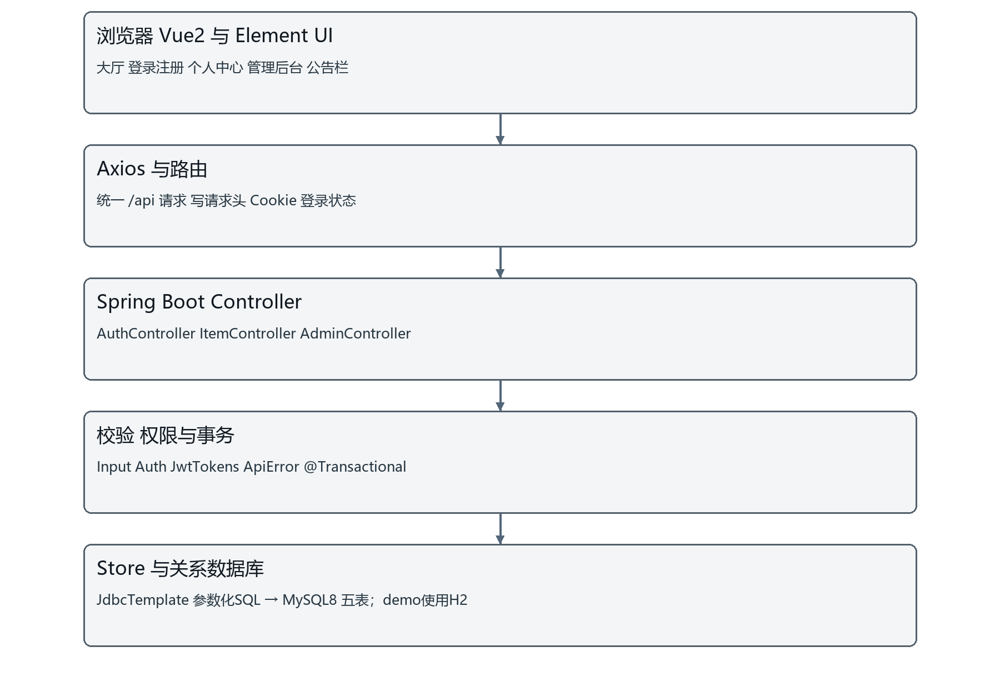

# 校园失物招领管理系统程序设计说明书

## 1 系统概述

### 1.1 设计目标与边界

本说明书将需求说明书FR01至FR12落实为页面、接口、数据访问和事务。程序服务于游客公开浏览、学生发布及认领、发布者确认和管理员审核维护，重点保证本人数据隔离、公告关联有效期及认领状态一致。

技术环境为JDK8、Spring Boot2.7.14、JdbcTemplate、MySQL8、Vue2.7.16、Vue Router3、Element UI2.15.14和Maven3。交付为包含前端静态页面的可执行WAR。演示profile使用独立H2，正式profile使用MySQL；没有实现校园统一身份认证或外部搜索引擎。

### 1.2 总体架构



浏览器中的Vue组件收集表单并通过api.js发送Axios请求；Controller按功能处理请求，Auth和JwtTokens验证身份，Input校验字段，Store封装JdbcTemplate查询与插入，最终操作五张关系表。业务跨表更新由Spring事务包裹；异常统一由ApiError转换为HTTP状态和message。

## 2 工程结构与模块职责

### 2.1 后端模块

| 类或资源 | 职责 | 关联需求 |
| --- | --- | --- |
| Application | Spring Boot入口与WAR容器支持 | 启动与部署 |
| AuthController | 注册、登录、当前用户、退出 | FR01 |
| Auth JwtTokens WebConfig | JWT、角色、账号状态、本人权限、写请求头 | FR01 FR09及全部受保护操作 |
| ItemController | 列表详情、发布维护、申请、招领确认与撤回 | FR02至FR07 |
| AdminController | 用户、审核、分类、公告和统计 | FR06 FR08至FR12 |
| Input Store ApiError | 字段校验、参数SQL与统一错误 | 全部模块 |
| SchemaUpgrade Bootstrap | 第一版表升级、管理员及演示初始化 | 数据兼容与运行 |
| schema.sql application.yml | 基础建表、profile、数据库和时间配置 | 数据库与部署 |

### 2.2 前端模块与页面

| 路由或组件 | 页面内容 | 数据来源 |
| --- | --- | --- |
| / 寻物大厅 | 发布入口、筛选、分页、详情、统计和公告摘要 | items categories notices stats |
| /login /register | 登录与学生注册 | auth接口 |
| /mine | 我的发布、我的申请、收到的申请 | mine过滤及claims接口 |
| /admin AdminPanel | 审核、全站物品、用户、分类、公告及统计 | admin接口 |
| /notices | 生效公告及关联跳转 | notices |
| ItemEditor | 物品表单 | items categories |
| IncomingClaims | 发布者核验与意见 | claims/incoming和confirm |
| NoticeEditor | 公告用途、业务关联和时间窗口 | admin/notices items categories |

登录后的管理员进入管理工作台，学生进入正常使用页面。前端路由与按钮只承担体验控制，所有身份和所有权必须再次由后端校验。公开大厅默认open，API本身在未传status时允许全状态查询，两者不能混淆。

## 3 接口公共约定

### 3.1 请求与身份

接口前缀为/api。GET使用查询参数，POST和PUT使用application/json请求体。浏览器由HttpOnly Cookie携带campus_token，也支持Authorization: Bearer凭证。写接口附X-Requested-With: campus；不通过前端代码向localStorage暴露JWT。后端从签名凭证与数据库确定操作者ID，忽略请求体中伪造的用户或审核人字段。

时间格式yyyy-MM-dd HH:mm:ss，时区Asia/Shanghai；数据库字段名与JSON字段使用下划线。创建操作通常返回{id}；列表物品返回{rows,total}，分类、公告和申请等列表直接返回数组；登录返回去除password的用户对象；维护操作返回message，编辑物品返回更新后的详情。当前没有统一的code/data响应外壳。

### 3.2 HTTP状态与异常

| 状态 | 意义 | 示例 |
| --- | --- | --- |
| 200 | 请求完成 | 创建、登录、列表或审核成功 |
| 400 | 参数或业务状态不满足 | 时间倒置、未经确认批准、重复处理 |
| 401 | 未登录或凭证失败 | 错误密码、过期、签名篡改、角色变化 |
| 403 | 权限或启用状态不满足 | 学生访问后台、修改他人数据、缺写请求头 |
| 404 | 目标记录不存在 | Store按ID查询未找到 |
| 409 | 数据库完整性冲突 | 重复账号、重复申请、引用分类删除 |
| 500 | 未预期异常 | 服务器日志保留技术信息，客户端通用提示 |

错误体为{"message":"原因说明"}。前端展示可理解的信息；日志用于定位技术原因，不向浏览器返回SQL、栈或密码。重复数据可能先被业务检查返回400，也可能由唯一键返回409，测试应按具体场景断言。

## 4 功能接口详细设计

### 4.1 接口全量目录

| 方法 | 路径 | 权限 | 输入及返回摘要 |
| --- | --- | --- | --- |
| POST | /api/auth/register | 游客 | student_number、name、phone、password；返回{id}；成功200 |
| POST | /api/auth/login | 游客 | account、password；返回不含password的用户对象；Set-Cookie |
| GET | /api/auth/me | 登录用户 | 无请求体；返回当前用户对象 |
| POST | /api/auth/logout | 携带凭证的使用者 | 无请求体；返回{message}；清除Cookie |
| GET | /api/categories | 公开 | 无；返回启用分类数组 |
| GET | /api/items | 公开；mine需登录 | keyword、location、category_id、type、status、occurred_from、occurred_until、page、size、mine；返回{rows,total}；列表移除contact |
| GET | /api/items/{id} | 公开，联系信息需登录 | 路径id；返回物品详情对象 |
| POST | /api/items | 登录用户 | title、type、category_id、location、occurred_at、description、contact；返回{id}；初始open |
| PUT | /api/items/{id} | 本人或管理员 | 路径id与发布字段相同；返回更新后的物品详情 |
| PUT | /api/items/{id}/status | 本人或管理员 | status=open/finished/closed；返回{message} |
| DELETE | /api/items/{id} | 本人或管理员 | 路径id；返回{message} |
| POST | /api/items/{id}/claims | 登录学生等有效用户 | 路径物品id；description为10至3000字符；返回{id}；主状态pending |
| GET | /api/claims/incoming | 登录用户 | 无；返回本人发布物品收到的申请数组 |
| PUT | /api/claims/{id}/confirm | 关联物品实际发布者 | decision=confirmed/rejected；reply为1至500字符；返回{message} |
| GET | /api/claims/mine | 登录用户 | 无；返回本人申请数组，含物品标题和状态 |
| DELETE | /api/claims/{id} | 申请本人 | 路径申请id；返回{message} |
| GET | /api/notices | 公开；all=true需管理员 | all默认false；返回公告数组，含关联名称 |
| GET | /api/admin/users | 管理员 | 无；返回用户列表，不含password |
| PUT | /api/admin/users/{id} | 管理员 | enabled布尔值；返回{message} |
| GET | /api/admin/claims | 管理员 | 无；返回申请数组及物品/申请人信息 |
| PUT | /api/admin/claims/{id}/review | 管理员 | status=approved/rejected；reply为1至500字符；返回{message} |
| GET | /api/admin/categories | 管理员 | 无；返回全部分类数组 |
| POST | /api/admin/categories | 管理员 | name、sort_no、enabled；返回{id} |
| PUT | /api/admin/categories/{id} | 管理员 | name、sort_no、enabled；返回{message} |
| DELETE | /api/admin/categories/{id} | 管理员 | 路径id；返回{message} |
| POST | /api/admin/notices | 管理员 | title、content、kind、item_id、category_id、enabled、published_at、starts_at、expires_at；返回{id} |
| PUT | /api/admin/notices/{id} | 管理员 | 路径id及公告字段；返回{message} |
| DELETE | /api/admin/notices/{id} | 管理员 | 路径id；返回{message} |
| GET | /api/stats | 公开 | 无；返回{total,open,finished} |
| GET | /api/admin/stats | 管理员 | 无；返回{pending,users,categories,types} |

接口目录覆盖当前Controller中的全部映射。权限“本人或管理员”仍须同时遵守物品状态；发布者确认只允许该物品的实际发布用户，不能由任意管理员代签。

### 4.2 注册 登录与退出

| 项目 | 设计内容 |
| --- | --- |
| URL | /api/auth/register |
| Method | POST |
| 功能与权限 | 游客；对应本小节功能 |
| 提交参数 | student_number、name、phone、password |
| 返回值 | {id}；成功200 |
| 要求与异常 | 字段合法；role后端固定user；唯一约束拦截重复 |

注册先校验字段长度、学号字符、手机号与BCrypt字节上限，最终由学号和手机号唯一约束阻止并发重复。role由后端固定为user，不接受自选管理员。BCrypt默认cost=10，随机盐包含在哈希中，不另设salt字段。

| 项目 | 设计内容 |
| --- | --- |
| URL | /api/auth/login |
| Method | POST |
| 功能与权限 | 游客；对应本小节功能 |
| 提交参数 | account、password |
| 返回值 | 不含password的用户对象；Set-Cookie |
| 要求与异常 | BCrypt验证；禁用403；凭据错误401 |

JWT含issuer=campus-lost-found、用户ID subject、role、随机jti、签发和过期时间，HS256签名，有效一小时。退出将jti保存在本进程内存撤销表，过期时清理；如果固定密钥并重启，内存撤销记录不会跨进程保留。当前设计适合单实例课程运行，不宣称支持分布式全局撤销。

### 4.3 物品发布 检索与维护

| 项目 | 设计内容 |
| --- | --- |
| URL | /api/items |
| Method | POST |
| 功能与权限 | 登录用户；对应本小节功能 |
| 提交参数 | title、type、category_id、location、occurred_at、description、contact |
| 返回值 | {id}；初始open |
| 要求与异常 | 标题2至100、描述5至5000、联系方式3至100；分类启用，时间合法 |

| 项目 | 设计内容 |
| --- | --- |
| URL | /api/items |
| Method | GET |
| 功能与权限 | 公开；mine需登录；对应本小节功能 |
| 提交参数 | keyword、location、category_id、type、status、occurred_from、occurred_until、page、size、mine |
| 返回值 | {rows,total}；列表移除contact |
| 要求与异常 | 关键词最长100字符、最多8词；size1至100；mine仅本人 |

检索对每个空格分词分别生成标题或描述的LIKE条件，所有分词以AND组合，参数绑定避免拼接用户SQL；!、%和_按转义字符处理。地点也使用参数LIKE，但不是独立中文分词引擎。总数查询与分页查询共享过滤条件，offset=(page-1)×size。

编辑物品先锁行并校验所有权、open状态、启用分类、发生时间与长度。有申请时禁止改变type。状态维护允许open至finished/closed以及finished至closed，非open时同步驳回待审申请。删除权限与所属校验一致，实际级联行为见数据库设计。

### 4.4 申请 招领确认与审核

| 项目 | 设计内容 |
| --- | --- |
| URL | /api/items/{id}/claims |
| Method | POST |
| 功能与权限 | 登录学生等有效用户；对应本小节功能 |
| 提交参数 | 路径物品id；description为10至3000字符 |
| 返回值 | {id}；主状态pending |
| 要求与异常 | 他人open found物品；一人一物唯一 |

| 项目 | 设计内容 |
| --- | --- |
| URL | /api/claims/{id}/confirm |
| Method | PUT |
| 功能与权限 | 关联物品实际发布者；对应本小节功能 |
| 提交参数 | decision=confirmed/rejected；reply为1至500字符 |
| 返回值 | {message} |
| 要求与异常 | 主状态与发布者状态均pending，物品open；非本人403 |

| 项目 | 设计内容 |
| --- | --- |
| URL | /api/admin/claims/{id}/review |
| Method | PUT |
| 功能与权限 | 管理员；对应本小节功能 |
| 提交参数 | status=approved/rejected；reply为1至500字符 |
| 返回值 | {message} |
| 要求与异常 | pending且物品open；批准另需confirmed；事务同步其他申请 |

招领人确认与管理员审核为两个阶段，不能用一个“审核状态”标签合并。publisher_status为confirmed后仍保持主status=pending。招领拒绝直接将主status改rejected并保留发布者说明，不伪造管理员审核人和审核时间。

### 4.5 分类 公告和统计

| 项目 | 设计内容 |
| --- | --- |
| URL | /api/admin/notices |
| Method | POST |
| 功能与权限 | 管理员；对应本小节功能 |
| 提交参数 | title、content、kind、item_id、category_id、enabled、published_at、starts_at、expires_at |
| 返回值 | {id} |
| 要求与异常 | 标题2至100；正文5至10000；提醒/结果至少一关联；截止严格晚于发布和生效 |

公告创建从管理员会话取得publisher_id，关联物品与分类须存在，reminder/result不能都为空；expires_at若不为空必须晚于published_at和starts_at。编辑保留原发布者。公开查询按启用及有效窗口过滤，all=true需管理员。

分类增改验证名称、整数排序与enabled；删除仍受外键约束。用户维护只启停学生，不提供修改角色。公共统计聚合total/open/finished，后台另查pending、users、categories与types，不将公共统计接口当成管理员敏感明细接口。

## 5 关键处理算法与一致性

### 5.1 认领批准算法

```text
校验当前管理员凭证与账号状态
读取申请以取得item_id
SELECT物品 FOR UPDATE
SELECT申请 FOR UPDATE
重新校验申请pending、物品open
若选择approved，要求publisher_status=confirmed
更新当前申请、审核人、意见和时间
若批准：更新物品finished及finished_at
若批准：其他pending申请统一rejected
提交事务；发生异常则整体回滚
```

所有竞争操作统一先锁物品，再锁申请，避免因交叉锁顺序引入不必要的死锁风险。两条申请并发批准时，第一个事务改变物品和另一申请状态，第二个事务获得锁后重新校验并拒绝，从而不会出现同物品两条approved。测试T12以两个线程真实请求验证这一点。

### 5.2 账号与对象权限算法

JWT先验证HS256签名、发行者、时间和必需字段，再依据subject读取用户，核验enabled与role一致。普通用户维护物品要求当前ID等于item.user_id，管理员可全站维护；申请撤回严格要求本人；招领确认要求item.user_id等于当前ID。禁用学生后，原Cookie仍存在也不能继续受保护操作。

### 5.3 公告显示算法

```text
enabled为TRUE
且published_at <= 当前时间
且starts_at <= 当前时间
且expires_at为空或expires_at > 当前时间
联查发布人，左联查物品和分类
按published_at与id倒序
```

物品被删时公告记录仍在，仅item_id置空。公开界面应优先判断关联是否存在再显示物品入口；类别关联仍在时可进入该分类。公告正文与私密认领证明没有自动同步，避免把归属核验细节泄露为公共线索。

## 6 界面交互与异常处理

### 6.1 状态展示

我的发布表用于维护本人记录；我的申请表同时显示申请主状态、招领人确认结果和管理员回复；收到的申请仅向物品发布者提供核验入口。后台通过按钮在未确认时禁用，同时后端再次拒绝不满足条件的批准请求。成功后刷新列表与统计，默认open大厅隐藏已完结记录。

### 6.2 输入 空数据与冲突

表单在前端校验必填、格式和主要长度，后端执行最终校验。无匹配记录显示空结果提示；凭证失效需要重新登录；400/403/409分别提示业务、权限或引用冲突；500给通用错误并在服务端保留堆栈。页面不把服务错误自动改为演示模式，以免误判数据库已经连接成功。

### 6.3 可维护性与边界

当前列表为面向课程规模的SQL查询，未做大数据压测。未实现请求幂等键、持久化审核日志表、跨实例撤销库和验证码找回密码。若以后扩展，需先补需求与数据迁移，不能直接把规划功能写成已交付功能。

## 7 程序测试与交付关联

程序测试位于backend/src/test/java/cn/campus/lostfound/WorkflowTest.java，共18项，覆盖权限、输入、并发、两阶段确认、公告时间关联和升级。数据库脚本与真实MySQL验证见第二份文档，完整用例和证据边界见第四份文档。

构建入口为build.cmd；完整运行包为release/campus-lost-found.war；本地最快演示start-demo.cmd；IDEA共享配置位于.run。后续修改同步本地web与GitHub，源代码路径、接口表、SQL字段与用户操作说明一起校对，保持六份说明书互相一致。
