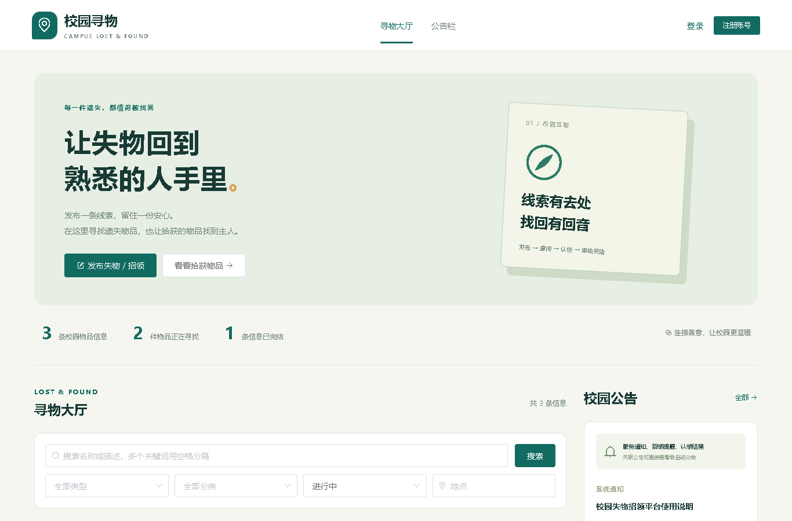
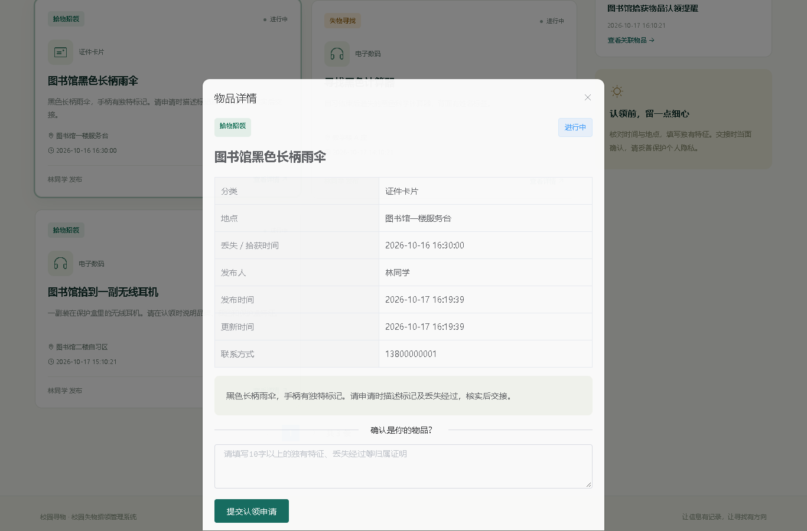
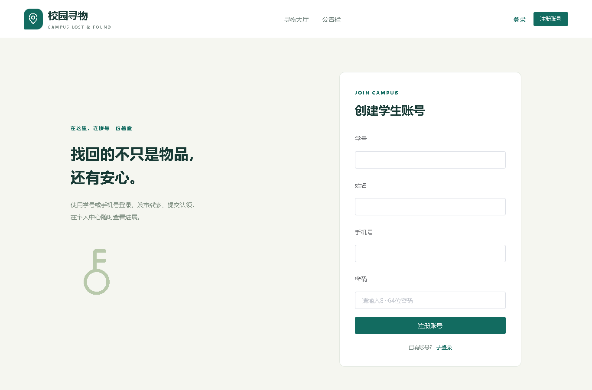
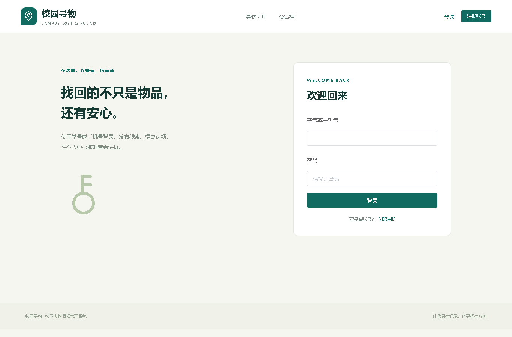
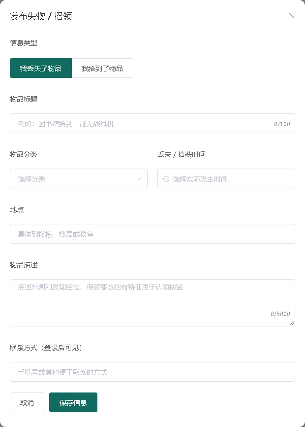
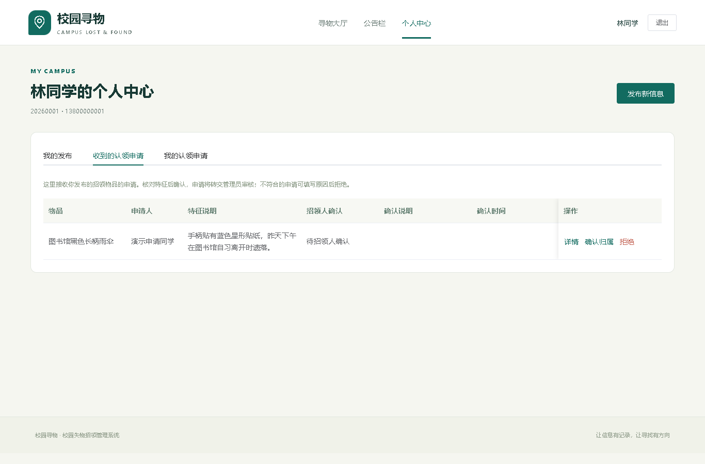
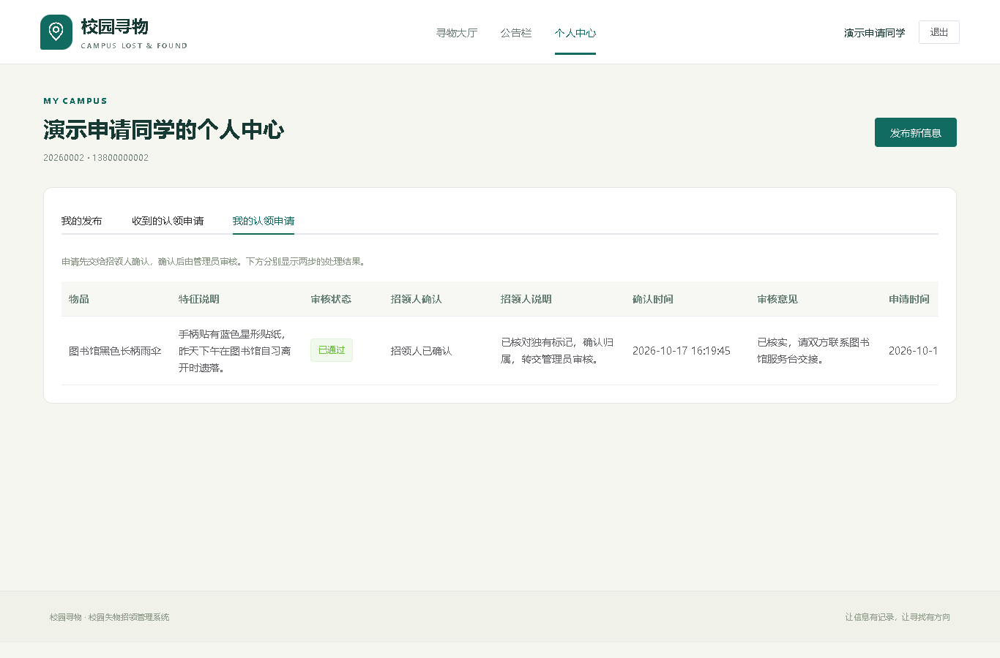
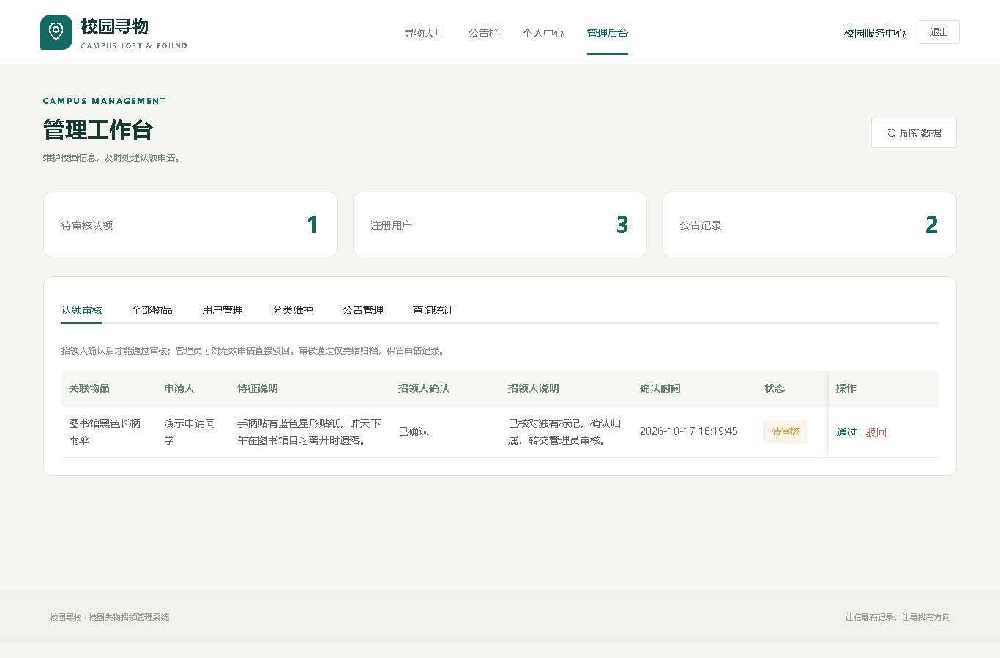
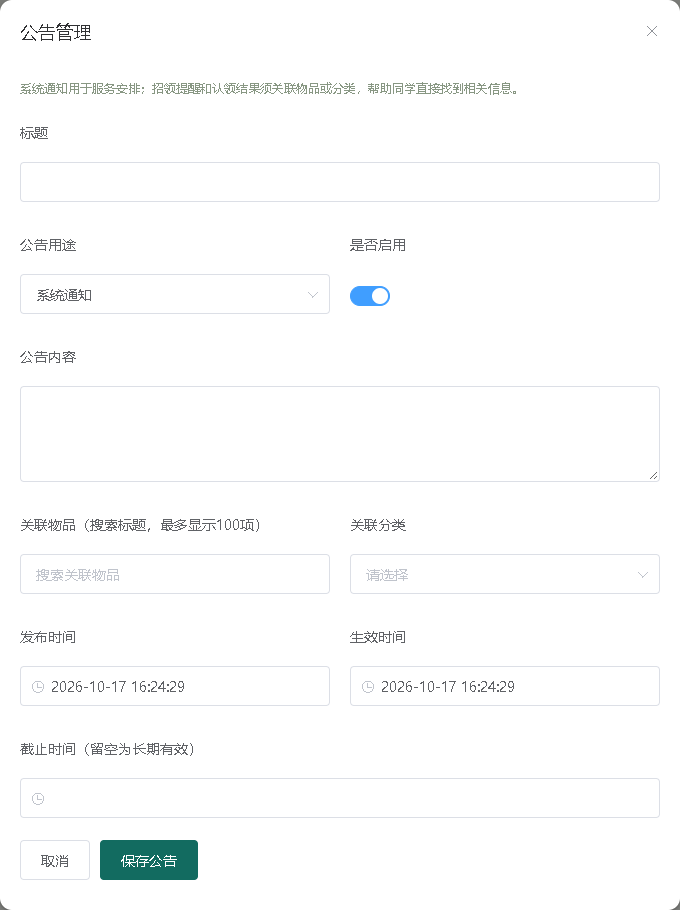

# 校园失物招领管理系统用户使用说明书

## 1 系统概述

### 1.1 适用对象与使用目标

本手册面向普通游客、学生用户和管理员。使用系统可以查看校园失物线索、发布遗失或拾获记录、提交归属证明，并查看招领人确认和管理员审核的结果。公告栏提供服务通知、招领提醒和认领结果，关联入口可直接定位相关物品或分类。

本地完整演示先由项目成员在web根目录双击start-demo.cmd，等待启动成功后，在浏览器打开http://localhost:8081。IDEA用于开发与启动，日常发布和认领在浏览器完成。不要双击.vue、.java或.war代替启动程序。本手册图片来自独立演示环境，数据与编号仅为操作示例。

### 1.2 角色与入口

| 角色 | 如何进入 | 主要操作 |
| --- | --- | --- |
| 游客 | 直接打开首页 | 查询物品、公开详情、公告 |
| 学生 | 注册后用学号或手机号登录 | 发布、本人维护、申请、招领确认、查看结果 |
| 管理员 | 用既有管理员账号登录 | 后台用户、物品、审核、分类、公告、统计 |

演示模式管理员为admin / Admin12345，学生为20260001 / Student123；正式MySQL管理员初始密码由部署者设置。用户无法通过注册页面选择成为管理员。登录信息属于个人凭据，不与公开截图一起提交。

## 2 主界面与信息查询

### 2.1 寻物大厅

导航栏包含寻物大厅和公告栏；登录后出现个人中心，管理员还可进入管理后台。首页提供“发布失物/招领”、关键词输入、分类、类型、状态、地点和实际发生时间筛选；下方为物品列表和分页，右侧为公告摘要。页面较长时向下滚动可看到完整筛选和列表。

大厅默认只显示进行中信息。找不到曾经看见的物品时，先将状态改为已完结或已关闭，清除过严的分类、地点和时间条件后再次查询。没有匹配结果会显示空列表提示，不代表账号或程序必然出错。

### 2.2 搜索与详情

输入物品名称或描述中的关键词并点击搜索；例如“黑色 雨伞”同时匹配两个词。再选择物品类型、分类和状态，填写地点，设置丢失/拾获时间的起止范围。起始不能晚于截止，这里筛选的是物品实际发生时间，而不是系统发布日。

点击物品卡片打开详情，核对标题、发布人、分类、地点、发生时间、描述和当前状态。游客看不到联系方式，需要先登录。只有进行中的招领物品可提出认领，失物记录是寻找线索，不会提供同样的认领操作。

## 3 注册与登录

### 3.1 学生注册

点击右上角“注册账号”，依次填写学号、姓名、手机号和密码。学号4至30位，仅字母或数字；姓名1至50字符；手机号为符合规则的11位号码；密码8至64字符且UTF-8不超过72字节。学号、手机号分别不能重复。点击注册后，按提示进入登录页面。

输入不符合格式时先修改后再提交。提示重复或冲突时确认是否已经注册，不要随意填写他人学号或手机号。当前系统没有学校学籍库核验，也没有短信验证码和找回密码入口，忘记密码请联系维护者处理。

### 3.2 登录与退出

填写学号或手机号与密码，点击登录。学生进入正常使用页面，管理员进入工作台。账号或密码错误时检查输入，账号被禁用时联系管理员。默认登录有效一小时，程序重启后也可能要求重新登录。

使用结束点击右上角“退出”，尤其在公共电脑上不要只关闭页面。若出现登录凭证失效，重新登录即可；反复出现无权限提示时不要通过改网页地址绕过，应确认账号角色与启用状态。

## 4 发布与维护本人信息

### 4.1 发布失物或招领

登录后点击“发布失物/招领”。自己丢失物品选择lost，拾获他人物品选择found。填写标题、分类、地点、实际丢失或拾获时间、描述及联系方式，再提交。标题至少2字，描述至少5字，联系方式至少3字符；发生时间不能填未来，分类要选择启用项。

描述应说明外观、物品类别和发现经过，保留用于核验归属的独特细节。不要公开完整校园卡号、身份证号或所有私密特征。联系方式用于双方交接，登录用户可在详情查看，列表不直接公开。

### 4.2 我的发布

进入个人中心“我的发布”，查看本人信息。进行中的记录可以编辑，已有认领申请时不能将招领改成失物或反向修改。找到失物或不再需要继续展示时，可按页面提供的操作完结或关闭。

完结和关闭均不能重新开启。正常认领通过后系统自动完结并保留历史。删除用于错误、重复或无效内容，会同时删除关联认领记录；如果只是结束寻找，应优先使用完结或关闭，避免丢失处理记录。

## 5 认领申请与个人中心

### 5.1 申请人的操作

找到可能属于自己的进行中招领物品，打开详情，填写至少10字的独有特征和丢失经过，点击“提交认领申请”。不能认领自己发布的物品，也不能重复保留同一物品的申请。不要只写“这是我的”，应提供可核对的具体依据。

进入个人中心“我的认领申请”，分别查看招领人确认结果和管理员审核状态。待审期间可撤回本人申请；已通过或驳回不能撤回。撤回会删除该申请，已驳回记录仍在时重复申请会被拒绝。

### 5.2 招领人的操作

用发布该found物品的账号登录，进入个人中心“收到的认领申请”。核对证明后点击“确认归属”，填写核对意见并转交管理员；不匹配时选择拒绝并说明原因。只有物品的实际发布者能执行这一环节。

确认归属后仍未最终批准，申请主状态继续为待审核。不要把“招领人已确认”理解为系统已经完结。物品已经关闭或申请已处理时，不能重复确认。

### 5.3 结果查看与线下交接

管理员通过后，申请状态显示已通过，物品显示已完结，其他待审申请自动驳回。申请人查看管理员回复，再根据联系方式与招领人线下核对交接。系统审核通过不等于已经签收，当前没有单独的交接签收按钮。

若申请一直待审，先看招领人是否确认；已经确认再等待管理员处理。若被拒绝，阅读招领人或管理员意见，确认时间地点和特征是否吻合，不要重复提交完全相同的信息。

## 6 管理员操作

### 6.1 认领审核

登录管理员账号进入“认领审核”，查看物品、申请人、归属证明、招领确认和意见。确认归属之前通过按钮不可用，后端也会拒绝直接批准。核实后选择通过或驳回，填写1至500字审核意见并提交。

通过时系统同步完结物品并处理其他待审申请；驳回不完结物品。已经处理的申请不能再次审核。管理员不能代替其他发布者作招领确认；不合理申请可以直接驳回。

### 6.2 用户 物品与分类

“用户管理”查看学生和管理员身份，按需启停学生，停用后该学生后续操作被拒绝，历史记录仍保留。管理员账号不允许通过此页面停用，也没有直接更改用户角色的功能。

“全部物品”用于全站查看、详情、完结、关闭或删除。删除前核对是否需保留申请记录。“分类维护”可新增分类，修改名称、整数排序和启用状态；有物品或公告引用时不能删除，改为停用。排序值较小的优先展示。

### 6.3 统计查看

“查询统计”显示分类和失物/招领数量，工作台另展示用户数及待审等事项。数量与当前数据库有关，演示数据被新增或清理后变化属于正常行为，不以手册截图中的数字作为固定验收值。

## 7 公告栏的使用与维护

### 7.1 公开公告

游客和登录用户都可以进入“公告栏”。系统通知说明服务安排；招领提醒提供待认领线索；认领结果公布经确认的结果。点击“查看关联物品”进入详情，或通过关联分类筛选相关信息。

公告只有在启用、已经发布、已经生效且未到截止时才公开。未来、过期、停用公告在后台仍能看到。物品删除后其公告保留，物品关联入口可能取消。

### 7.2 管理员发布公告

在“公告管理”点击“发布公告”，填写标题和正文，选择用途与启用状态。招领提醒或认领结果至少选择关联物品或分类之一；系统通知可不选。搜索物品标题后选择正确编号，避免误关联同名物品。

设置发布时间、生效时间和可选截止时间。截止为空表示长期，填写时必须晚于发布时间和生效时间。保存后在公开公告栏检查是否符合预期。不要将申请人的完整归属证明、私人联系方式或未确认结论直接写入公开公告。

## 8 常见问题与使用建议

| 问题 | 先检查什么 | 如何处理 |
| --- | --- | --- |
| 网页打不开 | 启动窗口是否仍运行 | 先启动程序，确认8081地址 |
| IDEA里打开Word看不正常 | 文件类型 | Word/WPS开docx，IDEA开工程 |
| 看不到联系方式 | 是否有效登录 | 登录后重新打开详情 |
| 找不到旧物品 | 大厅默认进行中 | 切换已完结或已关闭，清除过严筛选 |
| 申请不能提交 | 类型、本人、状态、重复 | 仅认领他人的open found物品 |
| 管理员不能通过 | 招领人是否已确认 | 由实际发布者核验后再审核 |
| 公告保存后不显示 | 启用与三个时间 | 核对发布、生效、截止和电脑时间 |
| 分类无法删除 | 是否被引用 | 优先停用，保留历史关联 |
| 不知道MySQL密码 | 是否只需演示 | 先用start-demo，不重置原数据库 |
| 两台电脑数据不同 | 是否各自启动本地实例 | 各自localhost是各自的数据，属正常情况 |

不要仅凭公开图片或标题就交付物品，交接时继续核对独有特征。发现异常内容及时联系管理员。结束使用主动退出；有错误提示时保留操作步骤、提示文字和必要截图，由维护者定位，不自行删除数据库文件。
